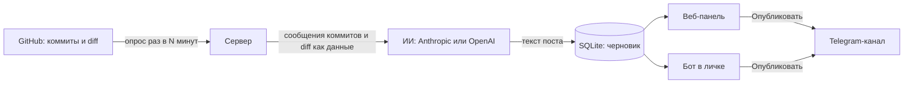
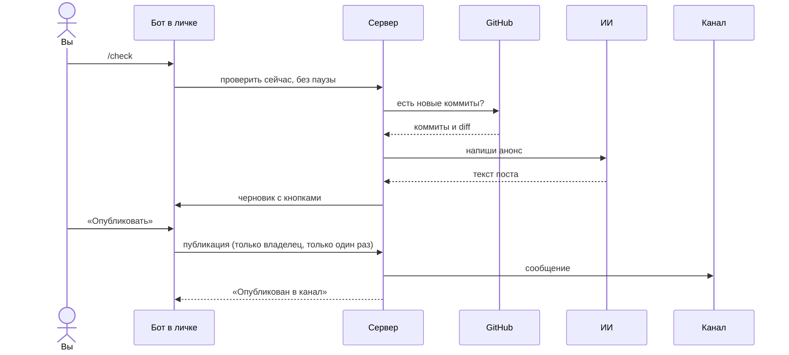

<p align="center">
  
</p>

# Анонсы из коммитов

Сервис следит за вашим репозиторием на GitHub, по новым коммитам пишет с помощью ИИ короткий анонс для подписчиков и публикует его в Telegram-канал, когда вы нажмёте «Опубликовать» в панели или в личке бота.

<p>
  
  
  
</p>

<picture>
  <source media="(prefers-color-scheme: dark)" srcset="docs/screens/after/draft-1280-dark.png">
  
</picture>

## Содержание

- [Как это работает](#как-это-работает)
- [Что умеет сейчас](#что-умеет-сейчас)
- [Быстрый старт на своём компьютере](#быстрый-старт-на-своём-компьютере)
- [Развёртывание на AWS EC2](#развёртывание-на-aws-ec2)
- [Подключение GitHub, Telegram и ИИ](#подключение-github-telegram-и-ии)
- [Команды бота](#команды-бота)
- [Безопасность](#безопасность)
- [Резервные копии, обновление, откат](#резервные-копии-обновление-откат)
- [Частые проблемы](#частые-проблемы)
- [Структура проекта](#структура-проекта)
- [Что отложено и планы](#что-отложено-и-планы)

## Как это работает

Сервер сам раз в несколько минут спрашивает GitHub о новых коммитах: вебхук не нужен. Когда после последнего коммита проходит пауза (по умолчанию 10 минут), сообщения коммитов и часть изменений в коде уходят в ИИ, и получается черновик. В канал он попадает только после вашей кнопки.



Так выглядит проверка по команде из бота:



## Что умеет сейчас

Честная таблица. «Запуск» — проверено запуском на машине разработчика, причём GitHub, Telegram и ИИ были подменены заглушками. «Тесты» — только автотестами (`npm test`, 111 тестов). **С настоящими GitHub, Telegram, Anthropic и OpenAI ничего не проверялось: ключей не было.**

| Функция | Как проверено |
|---|---|
| Новые коммиты → пауза → черновик от ИИ | Запуск + тесты |
| Публикация из панели, Ctrl+Enter, защита от двойной публикации | Запуск + тесты |
| Бот: `/check`, `/status`, `/help`, кнопки «Опубликовать», «Другой вариант», «Отклонить» | Запуск (заглушка Telegram) + тесты |
| Бот не отвечает никому, кроме владельца | Тесты |
| Привязка владельца по одноразовому коду, автопривязка канала | Тесты |
| Черновики в личку при новом коммите (по галочке) | Тесты |
| Сообщения владельцу о сбоях проверки и генерации | Тесты |
| Force-push: в пост попадают только новые коммиты | Тесты |
| Повтор при Telegram 429 и временных ошибках ИИ | Тесты |
| Подключение GitHub по токену | Запуск + тесты |
| Подключение через GitHub App | Тесты |
| ИИ Anthropic и OpenAI | Тесты |
| Режимы «Публиковать сразу» и «Дайджест раз в день» | Тесты |
| Панель: правки сохраняются по ходу набора, не теряются при обновлении и истёкшей сессии | Запуск в Chrome |
| Панель: телефон 390 px, светлая и тёмная темы, клавиатура (j, k, Esc), диалоги подтверждения | Запуск в Chrome |
| Вход, ограничение попыток, смена пароля, отзыв сессий | Запуск + тесты |
| Шифрование токенов в базе | Тесты |
| Docker-образ: сборка под x86 и ARM, запуск не от root, корректная остановка | Запуск (настоящий Docker) |
| HTTPS через Caddy | Не проверено |
| Резервная копия `scripts/backup.sh` | Запуск без Docker; через `docker compose` не проверено |
| Сброс пароля `scripts/reset-password.js` | Тесты |
| Развёртывание на AWS EC2 по инструкции ниже | Не проверено |

## Быстрый старт на своём компьютере

Нужны Node.js 22 или новее и Git. Команды для macOS и Linux:

```bash
git clone https://github.com/RahimovShaxriyor/gh-tg-poster.git && cd gh-tg-poster
npm ci --omit=dev --ignore-scripts
cat > .env <<EOF
ADMIN_PASSWORD=$(openssl rand -base64 18)
SESSION_SECRET=$(openssl rand -hex 32)
ENCRYPTION_KEY=$(openssl rand -hex 32)
DOMAIN=localhost:3000
PORT=3000
EOF
grep ADMIN_PASSWORD .env
node --env-file=.env server.js
```

Откройте <http://localhost:3000> и войдите с паролем, который показала команда `grep`. Дальше — [подключение GitHub, Telegram и ИИ](#подключение-github-telegram-и-ии).

`--ignore-scripts` не ошибка: у better-sqlite3 есть готовые сборки для Linux, macOS и Windows, а его установочный скрипт без компилятора падает.

## Развёртывание на AWS EC2

Инструкция для сервера x86 с Ubuntu. Целиком на настоящем EC2 она не проверялась: проверены только сборка и запуск образа.

1. **Сервер.** EC2 → Launch instance → Ubuntu Server 24.04 LTS, архитектура x86_64, тип `t3.micro` или `t3.small`. Создайте или выберите ключ SSH.
2. **Security group.** Входящие правила:
   - SSH, порт 22 — только ваш IP (`My IP`);
   - HTTP, порт 80 — `0.0.0.0/0` и `::/0` (нужен Caddy для выпуска сертификата);
   - HTTPS, порт 443 — `0.0.0.0/0` и `::/0`.
3. **Elastic IP.** EC2 → Elastic IPs → Allocate → Associate с вашим сервером. Без него адрес меняется при перезапуске сервера.
4. **Домен.** У регистратора домена создайте запись `A`: `poster.example.com` → Elastic IP. Проверка: `dig +short poster.example.com` показывает ваш IP.
5. **Docker.**
   ```bash
   ssh -i key.pem ubuntu@ВАШ_IP
   curl -fsSL https://get.docker.com | sudo sh
   sudo usermod -aG docker ubuntu
   exit   # войдите по SSH заново, чтобы группа docker применилась
   ```
6. **Код и настройки.**
   ```bash
   git clone https://github.com/RahimovShaxriyor/gh-tg-poster.git && cd gh-tg-poster
   cat > .env <<EOF
   ADMIN_PASSWORD=$(openssl rand -base64 18)
   SESSION_SECRET=$(openssl rand -hex 32)
   ENCRYPTION_KEY=$(openssl rand -hex 32)
   DOMAIN=poster.example.com
   PORT=3000
   EOF
   chmod 600 .env
   grep ADMIN_PASSWORD .env
   ```
   Если репозиторий приватный, вместо `git clone` соберите архив на своём компьютере командой `npm run pack` (архив появится рядом с папкой проекта) и скопируйте его на сервер: `scp -i key.pem ../ИМЯ_ПАПКИ.zip ubuntu@ВАШ_IP:`, затем `unzip`.
7. **Папка для базы.** Приложение в контейнере работает от пользователя с uid 1000. У пользователя `ubuntu` на EC2 обычно тот же uid (проверьте `id -u`), но надёжнее выставить владельца явно:
   ```bash
   mkdir -p data backups && sudo chown 1000:1000 data
   ```
8. **Запуск.**
   ```bash
   docker compose up -d --build
   docker compose ps          # app должен быть в состоянии healthy
   docker compose logs -f app # ждём строку «Готово: порт 3000»
   ```
9. **Проверка HTTPS.**
   ```bash
   curl -sI https://poster.example.com/health
   ```
   Ожидается `HTTP/2 200` и заголовок `strict-transport-security`. Затем откройте `https://poster.example.com` в браузере и войдите.
10. **Резервные копии** — см. [ниже](#резервные-копии-обновление-откат).

## Подключение GitHub, Telegram и ИИ

Всё настраивается в панели: **Настройки**. После каждого раздела нажмите «Проверить подключение».

### GitHub: токен

Проще всего: [Fine-grained tokens](https://github.com/settings/personal-access-tokens) → Generate new token → Repository access: **Only select repositories** (ваш репозиторий) → Permissions → **Contents: Read-only** (Metadata: Read-only добавится сам). Вставьте токен в **Настройки → GitHub → Токен GitHub**, выберите репозиторий и ветку.

### GitHub: GitHub App (необязательно)

Нужен, если не хотите следить за сроком действия токена.

<details>
<summary>Создание GitHub App</summary>

1. [GitHub → Settings → Developer settings → GitHub Apps → New GitHub App](https://github.com/settings/apps/new).
2. Поля:
   - **GitHub App name** — любое уникальное имя;
   - **Homepage URL** — `https://poster.example.com`;
   - **Callback URL** — оставьте пустым;
   - **Setup URL** — `https://poster.example.com/auth/github/setup`, включите **Redirect on update**;
   - **Webhook** — снимите **Active**;
   - **Repository permissions → Contents** — **Read-only**;
   - **Where can this GitHub App be installed?** — **Only on this account**.
3. **Create GitHub App**. На странице приложения возьмите **App ID** и slug из ссылки `https://github.com/apps/<slug>`.
4. **Private keys → Generate a private key**, скачается `.pem`. Переведите его в одну строку: `base64 -w0 key.pem` (Linux) или `base64 -i key.pem` (macOS).
5. Добавьте в `.env`:
   ```
   GITHUB_APP_ID=123456
   GITHUB_APP_SLUG=ваш-slug
   GITHUB_APP_PRIVATE_KEY_B64=строка-из-шага-4
   ```
   Переменную `GITHUB_APP_PRIVATE_KEY_PATH` в Docker используйте, только если смонтируете файл ключа в контейнер.
6. `docker compose up -d`, затем в панели **Настройки → GitHub → Подключить через GitHub App** и выберите репозиторий.

</details>

### Telegram: бот и канал

1. Напишите [@BotFather](https://t.me/BotFather) `/newbot` и получите токен. Вставьте его в **Настройки → Telegram → Токен бота** и сохраните.
2. **Получите код привязки** в том же разделе и отправьте боту в личку `/start КОД` (код действует 15 минут). Теперь вы владелец: бот отвечает только вам.
3. Добавьте бота **администратором канала** с правом публикации. Если сделать это со своего аккаунта после шага 2, канал подставится в настройки сам. Иначе впишите `@имя_канала` или числовой ID вида `-100…`.
4. Нажмите «Проверить подключение», затем «Отправить тест в канал».

### ИИ: ключ и модель

Ключ: [Anthropic Console](https://console.anthropic.com/settings/keys) или [OpenAI Platform](https://platform.openai.com/api-keys). Вставьте его в **Настройки → ИИ**, укажите модель и нажмите «Проверить подключение».

Для коротких анонсов хватает `claude-haiku-5-5`. `claude-sonnet-5-5` пишет аккуратнее и стоит дороже.

**Примерная стоимость одного поста.** Один пост — это примерно 3 000 входных токенов (коммиты, список файлов, часть diff) и около 400 выходных. Модели 5.5 ещё и рассуждают перед ответом, и эти токены оплачиваются как выходные, поэтому реальная цена выше расчёта. Каждый «Другой вариант» — ещё один такой запрос.

| Модель | Цена за 1 млн токенов, вход / выход | Пост, без учёта рассуждения |
|---|---|---|
| `claude-haiku-5-5` | $0.10 / $0.50 | ≈ $0.0005 |
| `claude-sonnet-5-5` | $2 / $10 | ≈ $0.01 |
| `claude-opus-5-5` | $4 / $20 | ≈ $0.02 |

Цены Anthropic по данным на 6 октября 2026 года. Перед использованием проверьте их на [странице цен](https://www.anthropic.com/pricing). Цены OpenAI смотрите на [их странице](https://openai.com/api/pricing/), здесь они не приводятся.

## Команды бота

Работают только в личке и только у владельца (см. привязку выше). Остальным бот не отвечает.

| Команда | Что делает |
|---|---|
| `/check` | Проверяет репозиторий сразу, не дожидаясь паузы. Есть новые коммиты — присылает черновик с кнопками «Опубликовать», «Другой вариант», «Отклонить». Нет — отвечает «Новых коммитов нет. Последний: abc1234, дата». |
| `/status` | Репозиторий и ветка, режим, время последней проверки, сколько черновиков ждёт, подключён ли канал. |
| `/help` | Список команд. |

Кнопка «Опубликовать» помнит текст, который вы видели. Если потом текст поправили в панели или ИИ написал другой вариант, кнопка ничего не опубликует и пришлёт актуальный черновик. Повторное нажатие пост второй раз не отправит.

## Безопасность

**Что и где хранится**

| Где | Что |
|---|---|
| `.env` на сервере | Пароль входа, ключ подписи сессий, ключ шифрования, ключ GitHub App. Права `600`, в git и в Docker-образ не попадает. |
| `data/app.db` | Настройки, токены GitHub и Telegram, ключ ИИ, история постов, хеш пароля, если вы меняли его в панели. Права `600`. |
| `backups/` | Копии `data/app.db`, права `600`. |

- Токены и ключ ИИ в базе зашифрованы AES-256-GCM ключом из `ENCRYPTION_KEY`. Без этой переменной они лежат открытым текстом, и панель об этом предупреждает.
- Пароль, сменённый в панели, хранится как хеш scrypt. Сессия — подписанная cookie на 7 дней (HttpOnly, SameSite=Lax, Secure под HTTPS). Смена пароля завершает все сессии.
- После 5 неверных паролей вход с этого IP закрывается на 10 минут.
- Запросы, меняющие данные, принимаются только со страницы самой панели (проверка Origin).
- Сообщения коммитов передаются ИИ как данные, а не как инструкции.

**Если что-то утекло**

- **Токен GitHub** — отзовите его в [настройках GitHub](https://github.com/settings/personal-access-tokens), создайте новый, в панели нажмите «Заменить».
- **Токен бота** — [@BotFather](https://t.me/BotFather) → `/revoke`, новый токен вставьте в панели. Привязка владельца сохранится.
- **Ключ ИИ** — удалите его в консоли провайдера и вставьте новый.
- **Пароль панели** — смените в **Настройки → Безопасность**, все сессии завершатся.
- **Забыли пароль, сменённый в панели** — `docker compose exec app node scripts/reset-password.js`, после этого действует `ADMIN_PASSWORD` из `.env`.
- **`.env` или база целиком** — придумайте новые `ADMIN_PASSWORD`, `SESSION_SECRET` и `ENCRYPTION_KEY`, перезапустите (`docker compose up -d`), затем замените все токены и ключ ИИ: со старым ключом шифрования панель их не прочитает и попросит ввести заново.

## Резервные копии, обновление, откат

**Копия.** `scripts/backup.sh` снимает копию средствами самого приложения (внутри контейнера, если он запущен), проверяет её целостность и удаляет копии старше 14 дней. Утилита `sqlite3` на сервере не нужна.

```bash
./scripts/backup.sh
crontab -e   # ежедневно в 03:00:
0 3 * * * cd /home/ubuntu/gh-tg-poster && ./scripts/backup.sh >> backups/backup.log 2>&1
```

Храните копию где-то ещё, кроме сервера, но отдельно от `.env`: в копии токены зашифрованы ключом из `.env`.

**Восстановление.**

```bash
docker compose stop app
cp backups/app_ДАТА.db data/app.db && rm -f data/app.db-wal data/app.db-shm
sudo chown 1000:1000 data/app.db
docker compose start app
```

**Обновление.**

```bash
./scripts/backup.sh
git pull
docker compose up -d --build
```

**Откат.** `git log --oneline`, затем `git checkout <коммит>` и `docker compose up -d --build`. Миграции базы только добавляют столбцы, поэтому старая версия обычно открывает новую базу. Это не проверялось, поэтому перед откатом восстановите копию, снятую до обновления.

## Частые проблемы

<details>
<summary>GitHub: 401 или 404</summary>

- **401** — токен истёк или отозван, либо GitHub App удалён. Создайте новый токен или подключите приложение заново.
- **404** — неверное имя репозитория или ветки, либо у токена нет доступа к этому репозиторию. У fine-grained токена проверьте Repository access.
- «Исчерпан лимит запросов GitHub» — проверка возобновится сама после указанного времени.

</details>

<details>
<summary>Telegram: «chat not found» или «bot is not a member»</summary>

Бот не добавлен в канал или не администратор. Добавьте его администратором с правом публикации. Проверьте, что в настройках указан `@имя_канала` или числовой ID `-100…`, а не ссылка `t.me/…`.

</details>

<details>
<summary>Caddy не выпускает сертификат</summary>

- Порт 80 должен быть открыт для всех в security group: Let's Encrypt проверяет домен по нему.
- Запись `A` домена должна указывать на Elastic IP. После изменения DNS подождите 5–10 минут.
- `docker compose logs caddy` покажет причину.

</details>

<details>
<summary>Бот молчит</summary>

- Бот отвечает только владельцу. Получите код в **Настройки → Telegram** и отправьте `/start КОД`.
- Тот же токен запущен ещё где-то (например, локальная копия): Telegram отдаёт обновления только одному получателю. В `docker compose logs app` будет ошибка `getUpdates` с текстом «Conflict». Остановите вторую копию.
- После смены токена бота привяжитесь заново.

</details>

<details>
<summary>Пост завис в состоянии «Пишется» или «Отправляется»</summary>

ИИ отвечает до двух минут, страница обновится сама. Если сервер перезапустился посреди работы, при старте такой пост получает статус «Ошибка» с пояснением:

- генерация прервалась — нажмите «Другой вариант»;
- отправка прервалась — сначала проверьте канал: пост мог уже дойти. Панель и бот попросят подтвердить повторную отправку.

</details>

<details>
<summary>Контейнер app перезапускается: «Папка data недоступна для записи»</summary>

`sudo chown -R 1000:1000 data` в папке проекта.

</details>

<details>
<summary>Сервер не стартует: «совпадает с примером из .env.example» или «Задай SESSION_SECRET»</summary>

Значения-заглушки из примера известны всем, с ними сервер не запускается. Сгенерируйте свои: `openssl rand -hex 32`.

</details>

## Структура проекта

```text
.
├── server.js                  запуск: проверка .env, опрос GitHub, цикл бота, остановка по SIGTERM
├── lib/
│   ├── app.js                 веб-сервер и API панели
│   ├── poster.js              проверка коммитов, генерация, публикация, статусы постов
│   ├── services.js            запросы к GitHub, Telegram и ИИ, промпт
│   ├── telegram-bot.js        команды и кнопки бота, привязка владельца
│   ├── notify.js              сообщения владельцу: черновики и сбои
│   ├── github-app.js          GitHub App: JWT, токены установки
│   ├── db.js                  база SQLite, миграции, восстановление после перезапуска
│   └── crypto.js              шифрование секретов, пароль, cookie сессии
├── public/
│   ├── index.html             разметка панели и SVG-иконки
│   ├── app.css                стили: светлая и тёмная темы
│   ├── app.js                 логика панели
│   └── favicon.svg            иконка вкладки
├── scripts/
│   ├── backup.sh              резервная копия базы
│   ├── backup-db.js           копия средствами SQLite с проверкой
│   ├── reset-password.js      сброс пароля, сменённого в панели
│   ├── screenshots.js         скриншоты панели на временной базе
│   ├── pack.sh                zip-архив для сервера (Linux, macOS)
│   └── pack.ps1               то же для Windows
├── test/                      автотесты (node --test)
├── docs/                      шапка, значки, скриншоты до и после
├── Dockerfile                 образ приложения
├── docker-compose.yml         приложение и Caddy
├── Caddyfile                  HTTPS и заголовки
└── .env.example               пример настроек
```

## Что отложено и планы

**Отложено сознательно**

- Форматирование постов (жирный, ссылки через `parse_mode`). Посты уходят обычным текстом: это безопасно и предсказуемо.
- Автоматический повтор упавших постов. Публикация идёт по кнопке, а о сбоях бот пишет в личку.
- Защита от вредных инструкций в коммитах сверх разделителей в промпте: в репозиторий пушите только вы.

**Можно сделать позже**

- Журнал событий: проверки, ошибки, публикации, смены настроек.
- Редактирование уже опубликованного поста через Telegram.
- Шаблоны постов: подпись, хэштеги, ссылка на релиз.
- Экспорт истории в CSV или JSON.
- Несколько репозиториев и каналов.
- Вебхук GitHub вместо опроса.
- `/health`, который сообщает о долгом отсутствии успешных проверок, для внешнего мониторинга.
