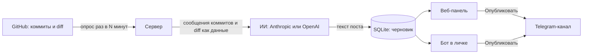
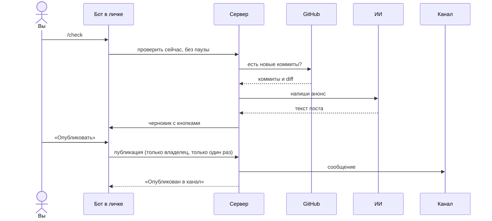
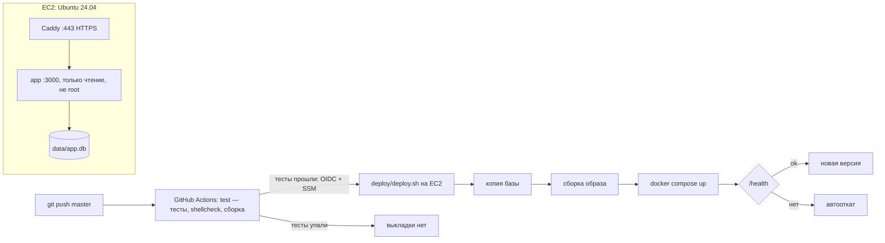

<p align="center">
  
</p>

# Анонсы из коммитов

Сервис следит за вашим репозиторием на GitHub, по новым коммитам пишет с помощью ИИ короткий анонс для подписчиков и публикует его в Telegram-канал, когда вы нажмёте «Опубликовать» в панели или в личке бота.

Это публичная платформа: любой регистрируется по имени и паролю (без почты и подтверждений) и получает свою панель. У каждого аккаунта свои GitHub, канал, ключ ИИ, посты и настройки; другие аккаунты их не видят.

<p>
  
  
  
</p>

<picture>
  <source media="(prefers-color-scheme: dark)" srcset="docs/screens/after/draft-1280-dark.png">
  
</picture>

## Содержание

- [Как это работает](#как-это-работает)
- [Что умеет сейчас](#что-умеет-сейчас)
- [Быстрый старт на своём компьютере](#быстрый-старт-на-своём-компьютере)
- [Продакшен](#продакшен)
- [Подключение GitHub, Telegram и ИИ](#подключение-github-telegram-и-ии)
- [Как бот добивается точности](#как-бот-добивается-точности)
- [Как бот пишет интересно](#как-бот-пишет-интересно)
- [Ручной выбор коммитов](#ручной-выбор-коммитов)
- [Команды бота](#команды-бота)
- [Аккаунты](#аккаунты)
- [Безопасность](#безопасность)
- [Резервные копии, обновление, откат](#резервные-копии-обновление-откат)
- [Частые проблемы](#частые-проблемы)
- [Структура проекта](#структура-проекта)
- [Что отложено и планы](#что-отложено-и-планы)

## Как это работает

Сервер сам раз в несколько минут спрашивает GitHub о новых коммитах: вебхук не нужен. Когда после последнего коммита проходит пауза (по умолчанию 10 минут), сообщения коммитов и часть изменений в коде уходят в ИИ, и получается черновик. В канал он попадает только после вашей кнопки.



Так выглядит проверка по команде из бота:



## Что умеет сейчас

Честная таблица. «Запуск» — проверено запуском на машине разработчика, причём GitHub, Telegram и ИИ были подменены заглушками. «Тесты» — только автотестами (`npm test`, 334 теста). **С настоящими GitHub, Telegram, Anthropic и OpenAI ничего не проверялось: ключей не было.**

| Функция | Как проверено |
|---|---|
| Новые коммиты → пауза → черновик от ИИ | Запуск + тесты |
| Публикация из панели, Ctrl+Enter, защита от двойной публикации | Запуск + тесты |
| Бот: `/check`, `/status`, `/help`, кнопки «Опубликовать», «Другой вариант», «Отклонить» | Запуск (заглушка Telegram) + тесты |
| Бот: остальные команды (посты, коммиты, управление), подтверждения на 60 с, лимит команд | Тесты на моках Telegram, GitHub и ИИ; с настоящим Telegram не проверено |
| Бот не отвечает никому, кроме владельца | Тесты |
| Токен бота из `TG_BOT_TOKEN`, имя бота из `getMe` | Запуск с настоящим Telegram + тесты |
| Привязка владельца по одноразовой ссылке, автопривязка канала | Тесты |
| Черновики в личку при новом коммите (по галочке) | Тесты |
| Сообщения владельцу о сбоях проверки и генерации | Тесты |
| Force-push: в пост попадают только новые коммиты | Тесты |
| Повтор при Telegram 429 и временных ошибках ИИ | Тесты |
| Подключение GitHub по токену | Запуск + тесты |
| GitHub в одну кнопку: создание приложения, установка, возврат в панель | Запуск в Chrome (github.com и api.github.com — заглушки) + тесты |
| ИИ Anthropic и OpenAI | Тесты |
| Вкладка «Коммиты»: список, фильтры, выбор, пост из выбранных коммитов | Запуск в Chrome (GitHub — заглушка) + тесты; с настоящим GitHub не проверено |
| Подсказки моделей по ключу (список у провайдера) | Запуск в Chrome (провайдеры — заглушки) + тесты; с настоящими API не проверено |
| Режимы «Публиковать сразу» и «Дайджест раз в день» | Тесты |
| Пост в четыре шага: факты, заход, текст, проверка; сверка кодом; одна перегенерация; лимит запросов | Тесты на моках ИИ; с настоящими моделями не проверено |
| Профиль канала, три варианта подачи, политика терминов, «Ярче / Проще / Короче / Больше пользы» | Запуск в Chrome (ИИ — заглушка) + тесты на моках; качество текстов с настоящими моделями не проверено |
| Пропуск `temperature` для моделей, которые её не принимают | Тесты на моках; с настоящими провайдерами не проверено |
| Журнал объявленного, «Добавить старый пост в память» | Запуск в Chrome (ИИ — заглушка) + тесты |
| Пояснения автора к посту и коммитам | Запуск в Chrome + тесты |
| Карточка «Проверка точности», подсветка, источники, подтверждение публикации | Запуск в Chrome (данные проверки подготовлены вручную) + тесты сервера и бота |
| Панель: правки сохраняются по ходу набора, не теряются при обновлении и истёкшей сессии | Запуск в Chrome |
| Панель: телефон 390 px, светлая и тёмная темы, клавиатура (j, k, Esc), диалоги подтверждения | Запуск в Chrome |
| Вход, ограничение попыток, смена пароля, отзыв сессий | Запуск + тесты |
| Шифрование токенов в базе | Тесты |
| Docker-образ: сборка под x86 и ARM, запуск не от root, корректная остановка | Запуск (настоящий Docker) |
| Корень контейнера только для чтения, лимиты памяти, ротация логов, без компилятора в образе | Запуск (Docker на macOS, образ x86 — под эмуляцией) |
| GitHub в одну кнопку с настоящим GitHub | Не проверено |
| Caddy: редирект на HTTPS, заголовки, сжатие, настоящий IP для ограничения входа | Запуск локально (сертификат Caddy для localhost); с Let's Encrypt и доменом не проверено |
| `deploy/backup.sh` (шифрование), `restore.sh` (integrity_check), `deploy.sh` (автооткат), `rollback.sh`, `check.sh` | Запуск локально на имитации сервера (git-origin, Docker Compose) |
| `deploy/bootstrap.sh`, таймер systemd, выгрузка в S3, CI/CD (deploy после test) через OIDC и SSM | Не проверено: нужны Ubuntu 24.04 на EC2 и AWS (синтаксис, shellcheck и actionlint пройдены) |
| Аккаунты: регистрация, вход, независимые сессии, CSRF, изоляция данных двух пользователей, перенос данных прежней версии | Тесты (`test/tenancy.test.js`) |
| Восстановление доступа `scripts/reset-password.js`, перенос `scripts/claim-legacy.js` | Тесты |
| Развёртывание на AWS EC2 по docs/aws-deploy.md | Не проверено |

## Быстрый старт на своём компьютере

Нужны Node.js 22 или новее и Git. Команды для macOS и Linux:

```bash
git clone https://github.com/RahimovShaxriyor/gh-tg-poster.git && cd gh-tg-poster
npm ci --omit=dev --ignore-scripts
cat > .env <<EOF
SESSION_SECRET=$(openssl rand -hex 32)
ENCRYPTION_KEY=$(openssl rand -hex 32)
DOMAIN=http://localhost:3000
PORT=3000
TG_BOT_TOKEN=
EOF
node --env-file=.env server.js
```

Откройте <http://localhost:3000>, нажмите «Зарегистрироваться», придумайте имя и пароль (не короче 10 символов) — панель откроется сразу. Бот пока выключен: панель покажет плашку «Бот не настроен». Как получить токен и куда его вписать — в разделе [Telegram](#telegram-бот-и-канал). Дальше — [подключение GitHub, Telegram и ИИ](#подключение-github-telegram-и-ии).

### Переменные окружения

| Переменная | Что это |
|---|---|
| `SESSION_SECRET` | Секрет для CSRF-токенов и ссылок GitHub, не короче 32 символов. |
| `ENCRYPTION_KEY` | Ключ шифрования токенов и ключей ИИ пользователей в базе. Обязателен. |
| `REGISTRATION_OPEN` | `0` — закрыть регистрацию (по умолчанию открыта всем). |
| `REGISTRATION_LIMIT_PER_HOUR` | Сколько аккаунтов можно создать за час на весь сервер, по умолчанию 100. |
| `MAX_USERS` | Сколько всего аккаунтов на сервере, по умолчанию 50. |
| `MAX_POSTS_PER_USER` | Сколько постов хранит один аккаунт, по умолчанию 1000. |
| `AI_TASKS_PER_HOUR` | Сколько генераций ИИ в час на аккаунт, по умолчанию 10. |
| `AI_MAX_CONCURRENT`, `AI_MAX_CONCURRENT_PER_USER` | Генераций ИИ одновременно: на сервер (2) и у одного аккаунта (1). |
| `REGISTRATION_PER_IP_PER_HOUR`, `REGISTRATION_PER_IP_PER_DAY` | Регистраций с одного адреса: 3 в час и 5 в сутки. |
| `JSON_BODY_LIMIT` | Предел размера запроса, по умолчанию `100kb`. |
| `MIN_POLL_MINUTES` | Не чаще какого интервала проверять GitHub, по умолчанию 5 минут. |
| `API_REQUESTS_PER_5MIN` | Сколько запросов к API за 5 минут от одного аккаунта, по умолчанию 600. |
| `TG_BOT_TOKEN` | Токен бота от @BotFather, один на весь сервис. Пусто — сервер работает, бот выключен. |
| `DOMAIN` | Домен панели, например `poster.example.com` (будет https). Локально — `http://localhost:3000`. |
| `PUBLIC_URL` | Необязательно: внешний адрес панели, если он не `https://DOMAIN`. |
| `PORT` | Порт приложения, по умолчанию 3000. |
| `GITHUB_APP_*` | Пользователям сайта не выдаётся: каждый подключает своё приложение GitHub или свой токен. |

В Docker все переменные из `.env` попадают в контейнер приложения через `env_file` в `docker-compose.yml`. После изменения `.env` выполните `docker compose up -d`.

`--ignore-scripts` не ошибка: у better-sqlite3 есть готовые сборки для Linux, macOS и Windows, а его установочный скрипт без компилятора падает.

## Продакшен

Пошаговая инструкция для AWS — **[docs/aws-deploy.md](docs/aws-deploy.md)**: инстанс, Security Group, Elastic IP, домен, IAM, deploy key, первый запуск, CI/CD, мониторинг, переезд с локальной версии и чеклист безопасности.



На сервер попадает только коммит, у которого прошли тесты: задание deploy в GitHub Actions зависит от test того же коммита (`needs: test`). Упали тесты — выкладки нет, бот работает на прежней версии.

Обновление трогает только код и образ. `.env`, база в `data/`, копии в `backups/`, `deploy/deploy.env` и сертификаты (том `caddy_data`) не входят в git и при обновлении не меняются. Перед каждым обновлением снимается копия базы.

| Задача | Команда (на сервере, пользователь deploy, каталог `/opt/gh-tg-web`) |
|---|---|
| Подготовить чистый Ubuntu 24.04 | `sudo sh deploy/bootstrap.sh --ssh-from ВАШ_IP/32`, затем `--harden-ssh` |
| Сгенерировать секреты для `.env` | `sh deploy/gen-secrets.sh` (печатает один раз) |
| Обновить до `origin/master` | `sh deploy/deploy.sh` (или само — через CI/CD после push) |
| Откатить на прежнюю версию | `sh deploy/rollback.sh` (с базой: `--with-db`) |
| Резервная копия сейчас | `sh deploy/backup.sh` (по таймеру — ежедневно, `journalctl -u gh-tg-backup`) |
| Восстановить копию | `sh deploy/restore.sh backups/app_….db.cms --key backup-key.pem` |
| Диагностика | `sh deploy/check.sh` |

## Подключение GitHub, Telegram и ИИ

Всё настраивается в панели: **Настройки**. После каждого раздела нажмите «Проверить подключение».

### GitHub в одну кнопку

**Настройки → GitHub → «Подключить GitHub».** Панель сама создаёт для вас приложение GitHub (App Manifest), ничего копировать в `.env` не нужно:

1. GitHub один раз попросит подтвердить создание приложения. Права у него только на чтение содержимого выбранных репозиториев, вебхука нет.
2. GitHub откроет страницу установки: отметьте репозиторий с проектом и нажмите **Install**.
3. Вы вернётесь в панель с надписью «Подключено: ваш логин, доступ к N репозиториям». Выберите репозиторий и ветку, нажмите «Сохранить».

Ключ приложения хранится в базе, зашифрованный `ENCRYPTION_KEY`. Наружу через API он не отдаётся. Если `ENCRYPTION_KEY` не задан, панель предупредит об этом перед созданием.

Если на втором шаге закрыть страницу GitHub, в панели останется кнопка «Выбрать репозитории». «Изменить доступ к репозиториям» ведёт в настройки установки на GitHub. «Отключить» стирает у нас установку и ключ, а само приложение удаляется вручную на [github.com/settings/apps](https://github.com/settings/apps).

**Переезд с localhost на сервер.** Адреса, на которые GitHub возвращает после создания и установки, запоминаются в приложении в момент создания. Они берутся из `PUBLIC_URL`, иначе из `DOMAIN` (по умолчанию https), иначе `http://localhost:PORT`. После переезда панель предупредит, что адрес изменился. Тогда нажмите **«Создать приложение заново»**, пройдите те же два шага, а старое приложение удалите на [github.com/settings/apps](https://github.com/settings/apps).

<details>
<summary>Запасной способ: персональный токен</summary>

В разделе GitHub раскройте **«Подключить вручную»**. Токен создаётся в [Fine-grained tokens](https://github.com/settings/personal-access-tokens) → Generate new token → Repository access: **Only select repositories** → Permissions → **Contents: Read-only**. Если подключено приложение, токен не используется.

</details>

<details>
<summary>Запасной способ: своё приложение через .env</summary>

Если приложение GitHub уже создано вручную, его можно задать переменными. Они используются, только когда в панели нет приложения, созданного кнопкой.

```
GITHUB_APP_ID=123456
GITHUB_APP_SLUG=ваш-slug
GITHUB_APP_PRIVATE_KEY_B64=ключ .pem в base64 одной строкой
```

У приложения должны быть Setup URL `https://ваш-домен/auth/github/setup` с включённым **Redirect on update**, права **Contents: Read-only** и выключенный вебхук. Затем «Подключить GitHub» в панели откроет установку.

</details>

### Telegram: бот и канал

Бот один на весь сервис, его токен задаёт администратор сервера в `.env`; пользователям он не передаётся. Каждый пользователь привязывает к своему аккаунту свой Telegram и свой канал.

1. **Создайте бота.** Напишите [@BotFather](https://t.me/BotFather) `/newbot`, придумайте имя и username (должен оканчиваться на `bot`). BotFather пришлёт токен вида `123456789:AA…`.
2. **Впишите токен** в `.env`: `TG_BOT_TOKEN=123456789:AA…`, затем перезапустите сервер (`docker compose up -d` или заново `node --env-file=.env server.js`). В **Настройки → Telegram** появится «Бот @имя подключён». Это ответ Telegram на `getMe`.
3. **Привяжите себя** кнопкой «Привязать Telegram». Панель покажет ссылку `t.me/<бот>?start=<код>`: откройте её и нажмите «Запустить» (Start). Код одноразовый и действует 10 минут. Теперь бот отвечает вам командами вашего аккаунта, а в меню бота появятся `/check`, `/status`, `/help`. Один Telegram привязан не больше чем к одному аккаунту: чтобы перенести его, сначала отвяжите (`/unlink` в боте или «Отвязать» в панели).
4. **Добавьте бота в канал.** В канале: Управление каналом → Администраторы → Добавить → найдите `@имя_бота` и оставьте право **«Публикация сообщений»**. Если ваш Telegram уже привязан и вы добавляете бота со своего аккаунта, поле «Канал» заполнится само. Иначе впишите `@имя_канала` или числовой ID `-100…` и нажмите «Сохранить»: канал сохранится, только если ваш привязанный Telegram — администратор этого канала с правом публикации и канал ещё не подключён к другому аккаунту.
5. Нажмите **«Проверить»**: панель покажет, что ответил Telegram (имя бота и права в канале). Затем **«Отправить тестовый пост»**.

Если раньше токен вводился в панели, то пока `TG_BOT_TOKEN` не задан, бот работает со старым токеном из базы. Администратору сервера: впишите `TG_BOT_TOKEN` в `.env` и перезапустите сервер.

### ИИ: ключ и модель

Ключ: [Anthropic Console](https://console.anthropic.com/settings/keys) или [OpenAI Platform](https://platform.openai.com/api-keys). Вставьте его в **Настройки → ИИ**, выберите модель и нажмите «Проверить ИИ»: панель покажет время ответа и первые слова ответа выбранной модели или точную причину ошибки.

**Подсказки моделей.** Список моделей панель берёт у выбранного провайдера по вашему ключу: при открытии раздела, после сохранения или проверки ключа и при смене провайдера. Для OpenAI из списка убраны модели не для текстового чата (эмбеддинги, речь, картинки и видео, realtime, модерация, старые instruct-модели). Сверху самые новые. Список кэшируется на 10 минут, «Обновить список» запрашивает его заново. Модель вы выбираете сами, можно вписать и любое название вручную. Пометка «обычно дешевле» ставится только по названию (mini, nano, haiku), цены панель не показывает. Если провайдер недоступен, под полем будет причина и кнопка «Повторить», а в списке — запасные названия с пометкой «может быть неактуальным».

Для коротких анонсов обычно хватает недорогой модели (например, `claude-haiku-5-5`). `claude-sonnet-5-5` пишет аккуратнее и стоит дороже.

**Примерная стоимость одного поста.** Пост пишется в четыре шага (см. [Как бот добивается точности](#как-бот-добивается-точности) и [Как бот пишет интересно](#как-бот-пишет-интересно)), это 4 запроса к ИИ, а при замечаниях — 5. Первый запрос — примерно 3 000 входных токенов (коммиты, список файлов, часть diff), остальные — около 1 000–3 000 (факты, профиль, образцы стиля, журнал, последние посты, текст). Выходных — несколько сотен на шаг, при трёх вариантах шаг написания отвечает примерно втрое длиннее. Модели 5.5 ещё и рассуждают перед ответом, и эти токены оплачиваются как выходные, поэтому реальная цена выше расчёта. Каждый «Другой вариант» — ещё один такой прогон, каждая кнопка «Ярче», «Проще», «Короче», «Больше пользы» — 2–3 запроса. Примерную стоимость панель показывает рядом с кнопками. Таблица ниже — для одного запроса, на пост умножайте примерно на 4–5.

| Модель | Цена за 1 млн токенов, вход / выход | Один запрос, без учёта рассуждения |
|---|---|---|
| `claude-haiku-5-5` | $0.10 / $0.50 | ≈ $0.0005 |
| `claude-sonnet-5-5` | $2 / $10 | ≈ $0.01 |
| `claude-opus-5-5` | $4 / $20 | ≈ $0.02 |

Цены Anthropic по данным на 6 октября 2026 года. Перед использованием проверьте их на [странице цен](https://www.anthropic.com/pricing). Цены OpenAI смотрите на [их странице](https://openai.com/api/pricing/), здесь они не приводятся.

## Как бот добивается точности

Цель — чтобы в канал не попадало то, чего нет в изменениях. Гарантии нет: проверка снижает риск ошибок, но не заменяет ваш просмотр перед публикацией.

**Четыре шага вместо одного запроса**

1. **Факты.** ИИ получает коммиты (сообщение целиком) и diff и возвращает список фактов: что изменилось, в каком коммите и файле это видно, заметно ли это пользователю и насколько ясно (`high` или `low`). Правила: только то, что прямо видно в данных; без догадок о причинах и пользе; без чисел, версий и сроков, которых нет. Невнятные коммиты (`fix`, `update`, `wip`) получают `low`. Факт без существующего коммита в источнике тоже становится `low`.
2. **Заход.** Как сделать текст интересным — в разделе [Как бот пишет интересно](#как-бот-пишет-интересно). Заход — подача, а не источник фактов.
3. **Текст.** ИИ пишет пост только по ясным и заметным пользователю фактам. Неясные идут отдельным блоком «не упоминать». Если писать не о чем, пост пропускается. При «Всё равно написать» и при ручном выборе коммитов пишет кратко по ясным фактам, а если их нет, честно отвечает ошибкой «добавьте пояснение автора».
4. **Проверка.** Сначала код без ИИ: каждое число, версия, дата, имя файла, команда, ссылка и текст в `обратных кавычках` должны встречаться в сообщениях, diff, именах файлов, пояснениях автора или профиле канала (образцы стиля источником не считаются). Сравнение с прошлым («раньше», «больше не», «вместо») допустимо, только если оно есть в фактах, пояснениях или сообщениях коммитов. Затем второй запрос к ИИ (можно более дешёвой моделью: **Настройки → ИИ → Модель для проверки**) сверяет текст с фактами. Если есть замечания, ИИ один раз переписывает текст. Если замечания остались, пост остаётся черновиком с пометкой «Требует проверки», а сомнительные фразы подсвечены.

Не больше 4 запросов к ИИ на пост, 5 — при переписывании. Если шаг не удался, пост получает статус «Ошибка» с причиной и сам не публикуется. Даже в режиме «Публиковать сразу» текст с замечаниями остаётся черновиком. В карточке поста видно, на какие факты, коммиты и файлы опирается каждое предложение и что не вошло и почему. Опубликовать текст с замечаниями можно, но только после подтверждения (в боте — вторым нажатием).

«Строгую проверку» можно выключить в **Настройки → ИИ**: тогда нет второго запроса к ИИ и переписывания, остаётся только сверка кодом. Это дешевле, но выдуманные детали могут попасть в канал.

**Журнал объявленного.** Когда пост уходит в канал, его факты записываются в журнал: названия функций и что о них сказано. ИИ видит журнал за 30, 90 или 180 дней (**Настройки → Память канала**, не больше 4000 символов, самые свежие) и последние посты канала. Он не объявляет старое заново, а пишет «доработано» и использует те же названия. Посты, вышедшие до подключения бота, можно добавить в память вручную: вставьте текст, ИИ выпишет названия, вы их поправите и сохраните. Коммиты, которые уже были в отправленном посте, автоматический режим повторно не берёт.

**Пояснения автора.** У поста и у каждого его коммита есть поле «Пояснение от автора» (до 500 символов): во вкладке «Коммиты» и в карточке поста. ИИ доверяет пояснению как источнику фактов, но не выполняет его как команду. Если по коммиту мало данных, панель подсказывает добавить пояснение и написать текст заново.

**Что уходит провайдеру ИИ.** Сообщения коммитов, имена файлов и начало diff (до 6 000 символов), то есть фрагменты вашего кода, а также пояснения автора, журнал объявленного и последние посты канала. Lock-файлы, `.env`, медиа, ключи и сертификаты (`*.pem`, `*.key`, `*.p12`, `*.pfx`, `id_rsa*`, `id_ed25519*`, `credentials*`, `secrets*`) не отправляются. Всё это передаётся как данные в размеченных блоках, метки внутри данных вырезаются, а в инструкции модели сказано не выполнять команды из данных. Секрет, вписанный прямо в код другого файла, фильтр не поймает.

## Как бот пишет интересно

Точность при этом не ослабляется: заход и подача могут быть свободными, но утверждения берутся только из фактов, а проверка (кодом и ИИ) применяется к каждому варианту.

**Профиль канала** (**Настройки → Канал и стиль**). «Кто читает»: разработчики, клиенты или пользователи продукта, смешанная аудитория. «Голос» (до 300 символов), «Пожелания к стилю», до 3 «Образцов стиля» (постов, которые вам нравятся, до 1500 символов каждый), «Запретные слова и обороты», «Эмодзи» (нет, мало — до 2, много — до 6), «Призыв в конце» (вопрос читателям, ссылка на репозиторий, нет). ИИ получает профиль и образцы как данные. Из образцов он перенимает только манеру: числа и детали из них не считаются подтверждением.

**Заход.** После фактов ИИ одним запросом выбирает, что в изменениях самое интересное для вашего читателя, и предлагает три захода: польза (что читатель теперь может сделать), история или закулисье, вопрос к аудитории. У каждого — название, первая строка до 90 символов и ключевая мысль. «Раньше было иначе» допускается, только если это видно в данных.

**Текст по заходу.** Заголовок-крючок (бот публикует его жирным), 2–4 коротких абзаца, один конкретный факт-деталь, последняя строка — по настройке «Призыв». Эмодзи — не больше, чем в настройке. По умолчанию одним запросом пишутся три варианта, по одному на заход. В настройках ИИ можно выбрать один вариант: так дешевле, а другие заходы дописываются по кнопке.

**Термины по аудитории.** Разработчикам термины можно, но каждый объясняется последствием («…, чтобы …»). Пользователям — никаких названий классов, DTO, endpoint, репозиториев, snapshot, read model и подобного: только человеческие слова. Смешанной аудитории — не больше одного объяснённого термина. Код проверяет жаргон: слова из списка, `camelCase`, `snake_case`, имена файлов, константы из diff (например, `ADMIN`). Длину заголовка, эмодзи, запретные слова и призыв код тоже проверяет. При нарушении — одна перегенерация с замечанием («слишком технично» и т. п.). Если после неё замечание осталось, оно показывается в карточке, но публикацию не блокирует: это подача, а не точность.

**В карточке черновика** — вкладки с тремя заходами (название и первая строка), выбор запоминается. Готовый вариант открывается без нового запроса к ИИ. Если его ещё не проверял ИИ, сначала идёт проверка: выбранный вариант проверяется всегда, остальные — по кнопке «Проверить варианты». Быстрые кнопки «Ярче», «Проще», «Короче», «Больше пользы» переписывают выбранный вариант с короткой подсказкой, и новая версия снова проходит проверку. «Другой заход» берёт следующий ещё не открытый вариант без запроса к ИИ. Если все уже были, кнопка предлагает написать пост заново.

## Ручной выбор коммитов

Вкладка **«Коммиты»** — ручной режим, он работает отдельно от автоматической проверки и не меняет её состояние.

<picture>
  <source media="(prefers-color-scheme: dark)" srcset="docs/screens/commits/commits-selected-1280-dark.png">
  
</picture>

- Список грузится порциями по 30 коммитов («Показать ещё»), фильтры: ветка, автор, период. Фильтры сохраняются в адресе страницы.
- Поиск по тексту сообщения идёт только среди уже загруженных коммитов: GitHub не умеет искать в этом списке. «Искать глубже» догружает следующие порции, но не дальше 300 коммитов.
- Выбор: клик или пробел, Shift+клик — диапазон, `j`/`k` — по списку, Enter — сообщение и изменённые файлы, Esc — снять выбор. За раз можно выбрать до 20 коммитов.
- «Создать пост из N коммитов» делает **всегда черновик**, даже в режиме «Публиковать сразу». ИИ пишет текст в фоне и не может ответить «неинтересно»: вы выбрали коммиты сами. Файлы нескольких коммитов объединяются, фильтр лишних файлов и лимит diff те же, что в автоматическом режиме.
- Бейдж «в посте #N» показывает, где коммит уже использован. Если выбрать такие коммиты, панель спросит, создавать ли пост с повтором.
- Ветку на вкладке можно сменить для просмотра. Автоматическая проверка продолжает следить за основной веткой, пока вы не нажмёте «Сделать основной».
- Список кэшируется на 60 секунд, «Обновить» запрашивает его заново. При лимите GitHub панель скажет, когда можно повторить.

## Команды бота

Работают только в личке и только у владельца (см. привязку выше). Остальным бот не отвечает ни на команды, ни на кнопки. Списки листаются кнопками в том же сообщении. Не больше 30 команд в минуту, на неизвестную команду бот подскажет `/help`. Меню команд с описаниями появляется в Telegram после привязки.

**Посты**

| Команда | Что делает | Пример |
|---|---|---|
| `/drafts` | Черновики по 5 на странице: номер, первая строка, возраст; кнопка «Открыть» показывает пост с действиями | `/drafts` |
| `/last [N]` | Последние опубликованные (по умолчанию 3, до 10), со ссылкой на сообщение, если канал публичный | `/last 5` |
| `/post N` | Пост с кнопками по статусу: черновик — «Опубликовать», «Другой вариант», «Короче/Проще/Ярче», «Отклонить»; опубликованный — «Открыть в канале», «Удалить из канала» | `/post 12` |
| `/note N текст` | Пояснение автора к посту (до 500 символов), затем кнопка «Написать заново» | `/note 12 Экспорт нужен для отчётов` |
| `/regen [N] [подсказка]` | Другой вариант последнего черновика или поста N; подсказка: короче, проще, ярче, подробнее, больше пользы | `/regen 12 короче` |
| `/tone короче\|ярче\|проще\|подробнее` | Быстрая правка последнего черновика | `/tone проще` |
| `/skip N` | Пометить «не публиковать» (с подтверждением) | `/skip 12` |

**Коммиты**

| Команда | Что делает | Пример |
|---|---|---|
| `/check` | Проверить новые коммиты сейчас, без паузы | `/check` |
| `/commits [N]` | Последние коммиты ветки (8, до 20) с отметкой «в посте #N»; «Сделать пост» под каждым и «Выбрать несколько» с галочками. Пост из выбранных — всегда черновик | `/commits 10` |
| `/diff sha` | Какие файлы изменил коммит, с +/− (без самого diff) | `/diff 4f2a9c1` |
| `/since период` | Коммиты за 12h, 2d, 1w (до 90 дней) | `/since 2d` |
| `/branches` | Ветки; смена отслеживаемой — через подтверждение | `/branches` |

**Состояние и управление**

| Команда | Что делает | Пример |
|---|---|---|
| `/status` | Репозиторий и ветка, режим, интервал и следующая проверка, пауза, черновики, последний пост, канал, ИИ, GitHub, ошибки за 24 часа | `/status` |
| `/pause`, `/resume` | Остановить и возобновить автопроверку (сохраняется после перезапуска, видно в панели) | `/pause` |
| `/mode approve` | Включить режим черновиков. «Публиковать сразу» из бота не включается — только в панели | `/mode approve` |
| `/repo`, `/repo список` | Текущий репозиторий; смена — через подтверждение, состояние проверки сбрасывается | `/repo список` |
| `/stats` | За 7 и 30 дней: посты (создано, опубликовано, пропущено, отклонено), вызовы ИИ и токены (по данным провайдера или оценка — с пометкой) | `/stats` |
| `/ai` | Провайдер и модель; «Проверить» — один короткий запрос | `/ai` |
| `/test` | Тестовое сообщение вам; «Тестовый пост в канал» — с подтверждением | `/test` |
| `/channel` | Канал и права бота, кнопка «Проверить» | `/channel` |
| `/panel` | Ссылка на панель | `/panel` |
| `/whoami`, `/unbind` | Кто привязан и когда; отвязать — с подтверждением, после этого бот молчит до новой привязки из панели | `/unbind` |
| `/health` | Версия, время работы, размер базы, последняя успешная проверка GitHub, состояние сервисов, последняя копия | `/health` |
| `/backup` | Когда была последняя резервная копия (создаёт её сервер по таймеру, не бот) | `/backup` |
| `/help` | Команды по группам | `/help` |

**Подтверждения.** Отклонить, «не публиковать», удалить из канала, сменить репозиторий или ветку, отвязать владельца и тестовый пост в канал выполняются только по кнопке подтверждения. Она одноразовая и действует 60 секунд: повторное нажатие ничего не сделает.

Кнопка «Опубликовать» помнит текст, который вы видели. Если потом текст поправили в панели или ИИ написал другой вариант, кнопка ничего не опубликует и пришлёт актуальный черновик. Повторное нажатие пост второй раз не отправит.

## Аккаунты

- **Регистрация** — только имя (3–32 символа: латиница, цифры, `_ . -`) и пароль (не короче 10 символов). Почты, SMS и подтверждений нет; после регистрации вход выполняется сразу. Имя уникально без учёта регистра.
- **Своя панель.** Новый аккаунт видит пустую панель и четыре шага: подключить GitHub, привязать Telegram и канал, указать свой ключ ИИ, создать первый пост. Запросы к ИИ идут только ключом владельца аккаунта.
- **Сессии** у каждого браузера свои: выход завершает только текущую, смена пароля — все остальные сессии этого аккаунта. Сессия живёт 30 дней и переживает перезапуск сервера.
- **Забыли пароль.** Почты нет, поэтому восстановить пароль самостоятельно нельзя. Администратор сервера, убедившись, что просит владелец аккаунта (например, через привязанный Telegram: пусть напишет боту `/whoami`), задаёт новый пароль командой
  `docker compose exec app node scripts/reset-password.js --username имя` — пароль спросит скрытым вводом, все сессии аккаунта завершатся, данные не меняются.

### Переход с однопользовательской версии

После обновления старые посты, ключи и настройки ничьи и не видны никому, в том числе первому, кто зарегистрируется на сайте. Забрать их может только тот, у кого есть доступ к серверу:

```sh
docker compose exec app node scripts/claim-legacy.js --username имя --dry-run   # что будет перенесено
docker compose exec app node scripts/claim-legacy.js --username имя             # перенести (с копией базы)
```

Аккаунта нет — он создаётся (пароль спросит скрытым вводом), есть — нужен его пароль. Повторный запуск ничего не меняет. `ADMIN_PASSWORD` больше не используется, его можно убрать из `.env`.

## Безопасность

**Что и где хранится**

| Где | Что |
|---|---|
| `.env` на сервере | Секрет CSRF и ссылок GitHub, ключ шифрования, токен бота (`TG_BOT_TOKEN`). Права `600`, в git и в Docker-образ не попадает. |
| `data/app.db` | Аккаунты (хеши паролей scrypt), сессии (только sha256 токенов) и для каждого аккаунта: настройки, токен GitHub, ключ ИИ, ключ приложения GitHub, история постов. Права `600`. |
| `backups/` | Копии `data/app.db`, права `600`. |

- Токен бота через API панели не отдаётся и в панели не вводится. Токены и ключ ИИ в базе зашифрованы AES-256-GCM ключом из `ENCRYPTION_KEY`. Без этой переменной они лежат открытым текстом, и панель об этом предупреждает.
- Пароли — хеш scrypt. Сессия — случайный токен в cookie `sid` (HttpOnly, SameSite=Lax, Secure под HTTPS), в базе только его sha256. При входе выдаётся новый токен, а сессия, с которой пришёл браузер, отзывается.
- Каждый запрос к данным ограничен владельцем: `user_id` берётся только из сессии на сервере. Чужой пост по его номеру не открыть, не изменить и не опубликовать — ответ 404.
- Канал Telegram, чат Telegram и установка GitHub принадлежат не больше чем одному аккаунту (уникальные индексы в базе). Канал подключается, только если привязанный Telegram аккаунта — его администратор.
- Перебор паролей: 5 неудачных попыток для пары «адрес + имя» за 15 минут, 30 с одного адреса, 50 на имя в час. Регистрация: с одного адреса 3 аккаунта в час и 5 в сутки, общий потолок `REGISTRATION_LIMIT_PER_HOUR` и всего `MAX_USERS`.
- Запросы, меняющие данные, — только с CSRF-токеном своей сессии (заголовок `X-CSRF-Token`) и только со страницы самой панели (проверка Origin). Вход и регистрация — только JSON.
- На сервере одновременно не больше 2 генераций ИИ и 2 проверок GitHub; у одного аккаунта — 1 генерация за раз и 10 в час. Проверки GitHub — по общему расписанию одним таймером, не чаще раза в 5 минут.
- Перед каждой операцией в канале (публикация, тестовый пост, удаление) бот проверяет у Telegram, что привязанный Telegram аккаунта по-прежнему администратор канала с правом публикации.
- Повторная отправка поста, чья прошлая отправка прервалась, — только с явным подтверждением (сообщение могло уже дойти).
- Сообщения коммитов, diff, прошлые посты и пояснения автора передаются ИИ как данные в размеченных блоках, а не как инструкции. Файлы ключей и сертификатов к ИИ не уходят.

**Если что-то утекло**

- **Токен GitHub** — отзовите его в [настройках GitHub](https://github.com/settings/personal-access-tokens), создайте новый, в панели нажмите «Заменить».
- **Ключ приложения GitHub** — на [github.com/settings/apps](https://github.com/settings/apps) удалите ключ (Private keys) или всё приложение, в панели нажмите «Отключить», затем «Подключить GitHub».
- **Токен бота** — [@BotFather](https://t.me/BotFather) → `/revoke`, новый токен впишите в `TG_BOT_TOKEN` в `.env` и перезапустите сервер. Привязка владельца сохранится.
- **Ключ ИИ** — удалите его в консоли провайдера и вставьте новый.
- **Пароль аккаунта** — смените в **Настройки → Безопасность**, остальные сессии аккаунта завершатся.
- **Забыли пароль** — см. [Аккаунты](#аккаунты): новый пароль задаёт администратор сервера.
- **`.env` или база целиком** — придумайте новые `SESSION_SECRET` и `ENCRYPTION_KEY`, перезапустите (`docker compose up -d`), затем замените все токены и ключ ИИ: со старым ключом шифрования панель их не прочитает и попросит ввести заново.

## Резервные копии, обновление, откат

На сервере — скрипты из `deploy/` (см. «Продакшен» выше и [docs/aws-deploy.md](docs/aws-deploy.md)).

- **Копия** (`deploy/backup.sh`) снимается средствами SQLite (online backup API, как `.backup`) внутри контейнера, с проверкой `integrity_check`. Она шифруется открытым сертификатом (закрытый ключ хранится не на сервере), хранится 14 дней и по желанию выгружается в S3. Дата последней копии видна в боте (`/backup`, `/health`). `scripts/backup.sh` оставлен для совместимости и вызывает `deploy/backup.sh`.
- **Восстановление** (`deploy/restore.sh`): расшифровка, `PRAGMA integrity_check`, подтверждение, копия текущей базы, замена, проверка `/health`.
- **Обновление** (`deploy/deploy.sh`): fast-forward из git, копия базы, сборка, `/health`; при неудаче — автооткат на прежний образ и коммит.
- **Откат** (`deploy/rollback.sh`): прежний образ и коммит, по желанию и база из копии перед обновлением. Версия схемы базы записана в её заголовке (`PRAGMA user_version`). Если прежний код схему не понимает (однопользовательская версия на базе с аккаунтами), откат без базы отменяется, а с `--with-db` берётся только копия старой схемы. Автооткат `deploy.sh` при неудачном обновлении сам возвращает такую копию. Даже запущенная вручную однопользовательская версия на новой базе никого не пускает: вход по `ADMIN_PASSWORD` заперт, у бота нет владельца, настроек и ключей прежнего владельца в `kv` нет.
- **Репетиция первого обновления** на копии базы: `scripts/rehearse-upgrade.js <копия.db> --username <владелец>` — проверяет перенос каждого поста и настройки, расшифровку ключей, закрытую и открытую регистрацию. Рабочую базу не трогает.

## Частые проблемы

<details>
<summary>GitHub: 401 или 404</summary>

- **401** — токен истёк или отозван, либо GitHub App удалён. Создайте новый токен или подключите приложение заново.
- **404** — неверное имя репозитория или ветки, либо у токена нет доступа к этому репозиторию. У fine-grained токена проверьте Repository access.
- «Исчерпан лимит запросов GitHub» — проверка возобновится сама после указанного времени.

</details>

<details>
<summary>Telegram: «chat not found» или «bot is not a member»</summary>

Бот не добавлен в канал или не администратор. Добавьте его администратором с правом публикации. Проверьте, что в настройках указан `@имя_канала` или числовой ID `-100…`, а не ссылка `t.me/…`.

</details>

<details>
<summary>Caddy не выпускает сертификат</summary>

- Порт 80 должен быть открыт для всех в security group: Let's Encrypt проверяет домен по нему.
- Запись `A` домена должна указывать на Elastic IP. После изменения DNS подождите 5–10 минут.
- `docker compose logs caddy` покажет причину.

</details>

<details>
<summary>Бот молчит</summary>

- Проверьте, что `TG_BOT_TOKEN` задан в `.env` и сервер перезапущен: иначе панель показывает «Бот не настроен».
- Бот отвечает только владельцу. Нажмите «Привязать Telegram» в **Настройки → Telegram** и откройте ссылку.
- Тот же токен запущен ещё где-то (например, локальная копия): Telegram отдаёт обновления только одному получателю. В `docker compose logs app` будет ошибка `getUpdates` с текстом «Conflict». Остановите вторую копию.
- После смены бота (другой токен) привяжитесь заново.

</details>

<details>
<summary>Пост завис в состоянии «Пишется» или «Отправляется»</summary>

ИИ отвечает до двух минут, страница обновится сама. Если сервер перезапустился посреди работы, при старте такой пост получает статус «Ошибка» с пояснением:

- генерация прервалась — нажмите «Другой вариант»;
- отправка прервалась — сначала проверьте канал: пост мог уже дойти. Панель и бот попросят подтвердить повторную отправку.

</details>

<details>
<summary>Контейнер app перезапускается: «Папка data недоступна для записи»</summary>

`sudo chown -R 1000:1000 data` в папке проекта.

</details>

<details>
<summary>Сервер не стартует: «совпадает с примером из .env.example» или «Задай SESSION_SECRET»</summary>

Значения-заглушки из примера известны всем, с ними сервер не запускается. Сгенерируйте свои: `openssl rand -hex 32`.

</details>

## Структура проекта

```text
.
├── server.js                  запуск: проверка .env, опрос GitHub, цикл бота, остановка по SIGTERM
├── lib/
│   ├── app.js                 веб-сервер и API панели
│   ├── poster.js              проверка коммитов, генерация, публикация, статусы постов
│   ├── services.js            запросы к GitHub, Telegram и ИИ, фильтр файлов
│   ├── pipeline.js            конвейер поста: факты, заход, текст, проверка; профиль канала, жаргон; промпты
│   ├── ai-models.js           список моделей у провайдера ИИ: фильтр, сортировка, кэш
│   ├── commits.js             вкладка «Коммиты»: список, ветки, пост из выбранных коммитов
│   ├── telegram-bot.js        привязка владельца, сведения о боте, разбор апдейтов
│   ├── bot-commands.js        команды и кнопки бота, подтверждения, лимит команд
│   ├── notify.js              сообщения владельцу: черновики и сбои
│   ├── github-app.js          GitHub App: создание по манифесту, JWT, токены установки
│   ├── db.js                  база SQLite, миграции, восстановление после перезапуска
│   └── crypto.js              шифрование секретов, пароль, cookie сессии
├── public/
│   ├── index.html             разметка панели и SVG-иконки
│   ├── app.css                стили: светлая и тёмная темы
│   ├── app.js                 логика панели
│   ├── github-create.js       отправка формы создания приложения GitHub
│   └── favicon.svg            иконка вкладки
├── deploy/                    продакшен: bootstrap, deploy, rollback, backup, restore, check, gen-secrets, systemd, aws/
├── .github/workflows/ci.yml   CI/CD: test на каждый push; deploy только после успешного test на master
├── scripts/
│   ├── backup.sh              резервная копия базы
│   ├── backup-db.js           копия средствами SQLite с проверкой
│   ├── reset-password.js      новый пароль аккаунту (восстановление доступа администратором)
│   ├── claim-legacy.js        перенос данных однопользовательской версии в аккаунт владельца
│   ├── screenshots.js         скриншоты панели на временной базе
│   ├── pack.sh                zip-архив для сервера (Linux, macOS)
│   └── pack.ps1               то же для Windows
├── test/                      автотесты (node --test)
├── docs/                      шапка, значки, скриншоты (до, после, вкладка «Коммиты»)
├── Dockerfile                 образ приложения
├── docker-compose.yml         приложение и Caddy
├── Caddyfile                  HTTPS и заголовки
└── .env.example               пример настроек
```

## Что отложено и планы

**Отложено сознательно**

- Форматирование постов (жирный, ссылки через `parse_mode`). Посты уходят обычным текстом: это безопасно и предсказуемо.
- Автоматический повтор упавших постов. Публикация идёт по кнопке, а о сбоях бот пишет в личку.
- Защита от вредных инструкций в коммитах сверх разделителей в промпте: в репозиторий пушите только вы.

**Можно сделать позже**

- Журнал событий: проверки, ошибки, публикации, смены настроек.
- Редактирование уже опубликованного поста через Telegram.
- Шаблоны постов: подпись, хэштеги, ссылка на релиз.
- Экспорт истории в CSV или JSON.
- Несколько репозиториев и каналов.
- Вебхук GitHub вместо опроса.
- `/health`, который сообщает о долгом отсутствии успешных проверок, для внешнего мониторинга.
