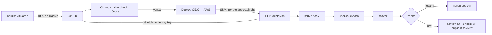

# Развёртывание на AWS

Один сервер EC2 (x86, Ubuntu 24.04), Docker Compose, Caddy с HTTPS, SQLite в `./data`. Обновления — из GitHub (вручную `deploy/deploy.sh` или автоматически через CI/CD). Личные данные при обновлении не трогаются.

> Ничего из этого не создано и не проверено на настоящем AWS. Скрипты и сборка проверены локально (см. README → «Продакшен»). Цены AWS здесь не приводятся: проверьте их на странице [AWS Pricing](https://aws.amazon.com/pricing/) и в [калькуляторе](https://calculator.aws/) в день создания.

## Что где лежит и что трогает обновление

| Что | Где на сервере | В git | Обновление |
|---|---|---|---|
| Код, Dockerfile, compose, Caddyfile, скрипты | `/opt/gh-tg-web` | да | меняется (fast-forward до проверенного коммита) |
| Пароли, ключи, токен бота | `/opt/gh-tg-web/.env` (600) | нет | **не трогается** |
| База (посты, настройки, токены в зашифрованном виде) | `/opt/gh-tg-web/data/app.db` | нет | **не трогается** (перед обновлением снимается копия) |
| Резервные копии | `/opt/gh-tg-web/backups/` | нет | не трогаются |
| Настройки скриптов | `/opt/gh-tg-web/deploy/deploy.env` | нет | не трогаются |
| Сертификаты HTTPS | том Docker `caddy_data` | нет | не трогаются (не запускайте `docker compose down -v`) |

`deploy.sh` откажется обновляться, если на сервере кто-то правил отслеживаемые файлы: они не будут потеряны молча.



> Рабочая ветка продакшена — **`master`**: из неё выкладывают CI/CD и `deploy/deploy.sh`. Сделайте её веткой по умолчанию на GitHub (Settings → General → Default branch), чтобы pull request и клоны шли от неё.

## 1. Инстанс EC2

**Тип.** x86 (`t3`/`t3a`), не меньше **2 ГБ памяти** — например, `t3.small`. Приложению хватает около 150–250 МБ, но сборка образа (`npm ci`) и Docker на 1 ГБ упираются в память. На `t3.micro` (1 ГБ) тоже можно: `bootstrap.sh` включит swap 1 ГБ, сборка пойдёт медленнее.

**Образ.** Ubuntu Server 24.04 LTS (x86_64).

**Диск.** gp3, 20 ГБ, **Encrypted: yes** (шифрование EBS, ключ `aws/ebs` по умолчанию).

**Метаданные: IMDSv2 обязателен.** В «Advanced details» → *Metadata version* → **V2 only (token required)**. Для уже созданного инстанса:
```sh
aws ec2 modify-instance-metadata-options --instance-id i-XXXX --http-tokens required --http-endpoint enabled
```

**Ключ SSH.** Создайте пару ключей (ed25519) и скачайте `.pem` (хранить на своём компьютере, `chmod 400`).

**Роль IAM инстанса** — шаг 6, её можно привязать позже.

## 2. Security Group

| Тип | Порт | Источник |
|---|---|---|
| HTTP | 80 | `0.0.0.0/0`, `::/0` (нужен для выпуска сертификата и редиректа) |
| HTTPS | 443 | `0.0.0.0/0`, `::/0` |
| SSH | 22 | **только ваш IP**: `x.x.x.x/32` |

Свой IP: откройте https://checkip.amazonaws.com. Если IP поменялся (домашний интернет), обновите правило в консоли (EC2 → Security Groups → Inbound rules → Edit) или командой:
```sh
MYIP=$(curl -s https://checkip.amazonaws.com)
aws ec2 revoke-security-group-ingress --group-id sg-XXXX --protocol tcp --port 22 --cidr СТАРЫЙ_IP/32
aws ec2 authorize-security-group-ingress --group-id sg-XXXX --protocol tcp --port 22 --cidr "$MYIP/32"
```
Без SSH вообще можно обойтись: **Session Manager** (EC2 → Connect → Session Manager) работает через ту же роль SSM и не требует открытого 22.

## 3. Elastic IP

EC2 → Elastic IPs → Allocate → Associate с инстансом. Адрес не меняется при перезапуске. Публичные IPv4-адреса в AWS платные — см. Pricing.

## 4. Домен

Caddy **не выпустит сертификат на голый IP**: нужен домен.

- **Свой домен:** купите у любого регистратора (или в Route 53) и создайте **A-запись** `poster.example.com → Elastic IP`. Проверка: `dig +short poster.example.com`.
- **Бесплатный поддомен динамического DNS** (например, DuckDNS: `name.duckdns.org`): укажите в нём Elastic IP. Let's Encrypt выпускает сертификаты и для таких поддоменов по HTTP-проверке, если A-запись указывает на сервер, а порт 80 открыт. **Я это не проверял**: если сертификат не выпустится, смотрите `docker compose logs caddy` (часто это лимиты Let's Encrypt на общий домен или ещё не обновившийся DNS).

В `.env`: `DOMAIN=poster.example.com`.

## 5. Подготовка сервера (`bootstrap.sh`)

```sh
# с вашего компьютера
ssh -i ~/keys/gh-tg.pem ubuntu@<Elastic IP>
# на сервере: скрипт берём из репозитория (до клонирования — скачать сырым файлом не выйдет, если репозиторий приватный,
# поэтому проще скопировать каталог deploy/ с компьютера):
#   scp -i ~/keys/gh-tg.pem -r deploy ubuntu@<IP>:/tmp/deploy
# ВАШ_IP узнайте на СВОЁМ компьютере (не на сервере): curl -s https://checkip.amazonaws.com
sudo sh /tmp/deploy/bootstrap.sh --ssh-from ВАШ_IP/32
```
Что делает (повторный запуск безопасен): часовой пояс UTC, обновления, Docker из официального репозитория, пользователь `deploy` (в группе `docker` — это равносильно root на этом сервере), UFW (80, 443, SSH только с вашего IP или с ограничением частоты), fail2ban для SSH, автоматические обновления безопасности, swap 1 ГБ при памяти меньше ~2,5 ГБ, таймер ежедневной копии.

Если ваш IP потом сменится, SSH закроют и Security Group, и UFW: обновите правило в Security Group, а UFW — через Session Manager (`sudo ufw allow from НОВЫЙ_IP to any port 22 proto tcp`).

Затем **в новом окне** проверьте вход по ключу пользователем deploy и только потом запретите пароли и root:
```sh
ssh -i ~/keys/gh-tg.pem deploy@<IP>          # должен пустить
sudo sh /tmp/deploy/bootstrap.sh --harden-ssh # в первом окне, от ubuntu
```

> Docker публикует порты 80 и 443 в обход UFW (свои правила iptables). Это нормально для этих двух портов; порт приложения 3000 наружу не публикуется.

## 6. IAM: роль инстанса (SSM и копии в S3)

1. **S3-бакет для копий** (необязательно): S3 → Create bucket, *Block all public access* — включено, шифрование по умолчанию SSE-S3, **Lifecycle rule**: удалять объекты с префиксом `gh-tg-web/` через 90 дней (у сервера нет права удалять — так задумано).
2. IAM → Roles → Create role → *AWS service: EC2*. Политики:
   - `AmazonSSMManagedInstanceCore` (управляемая; нужна для Session Manager и CI/CD);
   - встроенная политика из [`deploy/aws/instance-backup-policy.json`](../deploy/aws/instance-backup-policy.json) (замените `BUCKET_NAME`): только `s3:PutObject` и `s3:ListBucket` в одном префиксе одного бакета.
3. EC2 → инстанс → Actions → Security → Modify IAM role → выбрать роль.
4. На сервере для выгрузки: `sudo snap install aws-cli --classic`, в `deploy/deploy.env` — `S3_BUCKET=...`.

## 7. Доступ к репозиторию (deploy key)

Под пользователем deploy:
```sh
sudo -iu deploy
ssh-keygen -t ed25519 -f ~/.ssh/gh_tg_deploy -N "" -C "gh-tg-web deploy key"
cat >> ~/.ssh/config <<'EOF'
Host github.com
  IdentityFile ~/.ssh/gh_tg_deploy
  IdentitiesOnly yes
EOF
cat ~/.ssh/gh_tg_deploy.pub
```
GitHub → репозиторий → Settings → Deploy keys → Add deploy key, вставить ключ, **Allow write access — не отмечать** (только чтение). Затем:
```sh
ssh -T git@github.com   # «Hi RahimovShaxriyor/gh-tg-poster! You've successfully authenticated…»
git clone -b master git@github.com:RahimovShaxriyor/gh-tg-poster.git /opt/gh-tg-web
```
Альтернатива — fine-grained токен GitHub с доступом *Contents: Read-only* только к этому репозиторию; хранить его в `~/.git-credentials` с правами 600.

## 8. Ключ для резервных копий

Копии шифруются открытым сертификатом; закрытый ключ **никогда не лежит на сервере**. На своём компьютере:
```sh
openssl req -x509 -newkey rsa:4096 -nodes -keyout backup-key.pem -out backup-cert.pem -days 3650 -subj "/CN=gh-tg-web backup"
```
`backup-key.pem` — в менеджер паролей (или на зашифрованный носитель). `backup-cert.pem` — на сервер в `/opt/gh-tg-web/deploy/backup-cert.pem`.

## 9. Первый запуск

```sh
sudo -iu deploy
cd /opt/gh-tg-web
sh deploy/gen-secrets.sh                 # значения печатаются один раз — сразу в менеджер паролей
cp .env.production.example .env && chmod 600 .env && nano .env
#   ADMIN_PASSWORD, SESSION_SECRET, ENCRYPTION_KEY — из gen-secrets
#   TG_BOT_TOKEN — токен бота; DOMAIN — ваш домен
#   APP_UID и APP_GID — вывод `id -u` и `id -g` пользователя deploy
cp deploy/deploy.env.example deploy/deploy.env && chmod 600 deploy/deploy.env
mkdir -p data backups && chmod 700 data backups
sh deploy/deploy.sh
sh deploy/check.sh
```
`deploy.sh` при первом запуске соберёт образ и поднимет приложение и Caddy. Caddy получит сертификат за несколько секунд после того, как DNS указывает на сервер. Откройте `https://ваш-домен`.

Проверьте резервное копирование и восстановление **до того, как начнёте пользоваться**:
```sh
sh deploy/backup.sh
journalctl -u gh-tg-backup --since today   # таймер: systemctl list-timers gh-tg-backup.timer
# восстановление проверяется на своём компьютере: скачайте копию и расшифруйте
openssl cms -decrypt -binary -inform DER -in app_….db.cms -inkey backup-key.pem -out check.db
sqlite3 check.db 'PRAGMA integrity_check;'   # ok
```

## 10. CI/CD: обновление из GitHub

После настройки каждое изменение в `master` проходит CI (тесты, shellcheck, сборка) и само выкладывается на сервер. Пока переменные не заданы, шаг выкладки пропускается — обновлять можно вручную (`sh deploy/deploy.sh`).

1. **OIDC-провайдер GitHub в AWS** (один раз): IAM → Identity providers → Add provider → OpenID Connect, URL `https://token.actions.githubusercontent.com`, Audience `sts.amazonaws.com`.
2. **Документ SSM**, который умеет только запустить `deploy.sh` с sha: Systems Manager → Documents → Create document → Command, имя `GhTgWebDeploy`, содержимое — [`deploy/aws/ssm-deploy-document.json`](../deploy/aws/ssm-deploy-document.json). Или:
   ```sh
   aws ssm create-document --name GhTgWebDeploy --document-type Command --document-format JSON --content file://deploy/aws/ssm-deploy-document.json
   ```
3. **Роль для GitHub**: IAM → Roles → Create role → *Web identity*, провайдер из п. 1. Доверие — [`deploy/aws/github-oidc-trust.json`](../deploy/aws/github-oidc-trust.json) (подставьте `ACCOUNT_ID`; роль принимается только из окружения `production` этого репозитория). Права — [`deploy/aws/github-deploy-policy.json`](../deploy/aws/github-deploy-policy.json): запуск только документа `GhTgWebDeploy` только на вашем инстансе.
4. **GitHub → Settings → Environments → New environment `production`**. Можно включить *Required reviewers* — тогда каждая выкладка ждёт вашего подтверждения.
5. **Settings → Secrets and variables → Actions → Variables**: `AWS_DEPLOY_ROLE_ARN`, `AWS_REGION`, `AWS_INSTANCE_ID`. Ключей AWS в GitHub не хранится.
6. Проверка: Actions → Deploy → *Run workflow*. В логе — вывод `deploy.sh` с сервера.

Как это работает: [`.github/workflows/ci.yml`](../.github/workflows/ci.yml), [`.github/workflows/deploy.yml`](../.github/workflows/deploy.yml). Выкладывается **ровно тот коммит, который прошёл CI**; `deploy.sh` проверяет, что он есть в `origin/master`, и обновляется только fast-forward.

## 11. Обновление, откат, восстановление вручную

```sh
sudo -iu deploy && cd /opt/gh-tg-web
sh deploy/deploy.sh                # обновиться до origin/master (копия базы → сборка → /health → иначе откат)
sh deploy/rollback.sh              # вернуться на предыдущую версию (код и образ)
sh deploy/rollback.sh --with-db    # и базу из копии перед последним обновлением
sh deploy/restore.sh backups/app_….db.cms --key /tmp/backup-key.pem   # восстановить копию (ключ потом удалить: shred -u)
sh deploy/check.sh                 # диск, память, контейнеры, /health, сертификат, последняя копия
```

## 12. Мониторинг

- **Внешняя проверка**: [UptimeRobot](https://uptimerobot.com/) или аналог — монитор HTTP(s) на `https://ваш-домен/health`, ключевое слово `ok`, уведомления на почту или в Telegram.
- **CloudWatch (по желанию)**: аларм `StatusCheckFailed_System` на инстанс с действием *Recover*, уведомление через SNS на почту. Свободное место на диске CloudWatch без агента не видит: следите через `deploy/check.sh` или `/health` в боте.
- **Бот**: `/health`, `/status` (ошибки за 24 часа), `/backup`.

## 13. Переезд с локальной версии

1. **Остановите локальный сервер** (Ctrl+C или `docker compose down` у себя). Один токен бота — один процесс: два процесса перехватывают сообщения друг у друга.
2. **GitHub App**: приложение, созданное на `localhost`, привязано к адресам localhost. На сервере в панели: Настройки → GitHub → **«Создать приложение заново»** (уже с https-доменом). Старое удалите на [github.com/settings/apps](https://github.com/settings/apps).
3. **База**: переносить не обязательно — на сервере начнётся чистая история. Если нужна история постов:
   - остановите локальный сервер, скопируйте `data/app.db` через `scp` во временную папку сервера, затем `sh deploy/restore.sh /tmp/app.db` (проверка целостности и подтверждение включены);
   - **ENCRYPTION_KEY на сервере должен совпадать с локальным**, иначе токены и ключи в базе не расшифруются (их придётся ввести заново); привязка GitHub App из локальной базы всё равно указывает на localhost — создайте приложение заново;
   - после переноса удалите временный файл: `shred -u /tmp/app.db`.
4. **Владелец бота**: в новой базе его нет — в панели получите код и нажмите ссылку в Telegram. Канал привяжется сам, если добавить бота администратором со своего аккаунта, или впишите `@канал`.
5. **Порядок включения**: режим **«Черновики»**, в боте **`/pause`**, проверьте всё (панель → «Проверить» у GitHub, Telegram, ИИ; бот `/channel`, `/ai`, `/health`), сделайте и проверьте копию, и только потом **`/resume`**.

## 14. Чеклист безопасности

- [ ] `ADMIN_PASSWORD` длинный и **новый** (не тот, что был локально и в тестах); `SESSION_SECRET` и `ENCRYPTION_KEY` из `gen-secrets.sh`.
- [ ] `ENCRYPTION_KEY` и `backup-key.pem` сохранены в менеджере паролей, `backup-key.pem` на сервере нет.
- [ ] `.env` с правами 600 и не в репозитории; репозиторий приватный.
- [ ] GitHub App: права только *Contents: Read-only* (так создаёт кнопка в панели); deploy key — только чтение.
- [ ] SSH только по ключу, root по SSH запрещён (`bootstrap.sh --harden-ssh`), 22 открыт только с вашего IP (или закрыт совсем — Session Manager).
- [ ] IMDSv2 обязателен, EBS зашифрован.
- [ ] Автоматические обновления включены (`unattended-upgrades`), Docker-образы обновляются при `deploy.sh` (Caddy — `caddy:2.10`).
- [ ] Копия базы проверена **восстановлением**, а не только наличием файла.
- [ ] Токен бота перевыпущен у [@BotFather](https://t.me/BotFather) (`/revoke`), если он когда-либо попадал в чаты, скриншоты или логи.
- [ ] В GitHub environment `production` включены *Required reviewers* (если не хотите выкладку без подтверждения).

## 15. Что проверить вручную на сервере (не проверено без AWS)

- [ ] `bootstrap.sh` на чистом Ubuntu 24.04: Docker, UFW, fail2ban, swap, таймер; затем `--harden-ssh`.
- [ ] Сертификат Let's Encrypt для вашего домена (и для поддомена DuckDNS, если выбран он).
- [ ] Настоящий IP клиента в приложении: 5 неверных паролей с вашего адреса → шестой запрос получает 429 (локально проверено через Caddy, на сервере — проверить).
- [ ] Таймер копий: `systemctl list-timers gh-tg-backup.timer`, на следующий день — новый файл в `backups/` и запись в `journalctl -u gh-tg-backup`.
- [ ] Выгрузка в S3 с ролью инстанса (`S3_BUCKET` в `deploy/deploy.env`).
- [ ] CI/CD: OIDC → роль → документ SSM → `deploy.sh`; выкладка по *Run workflow* и после push в `master`.
- [ ] Session Manager подключается (агент SSM есть в образах Ubuntu от Canonical; проверьте `snap list amazon-ssm-agent`).
- [ ] Перезапуск инстанса: после него приложение поднимается само (`restart: unless-stopped`), пауза бота сохраняется.
